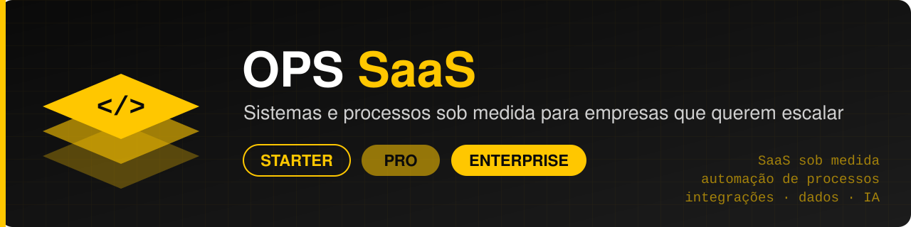

<h3 align="center">Sistemas que resolvem. Processos que escalam.</h3>

A <b>OPS SaaS</b> desenvolve sistemas sob medida — do diagnóstico do processo ao SaaS em produção — 
para empresas que querem parar de depender de planilhas, retrabalho e ferramentas que não conversam entre si.

---

## 🎯 Problemas que resolvemos

| Se a sua empresa... | A OPS entrega |
|---|---|
| Vive de planilhas e controles manuais | **Sistema web** com fluxo, permissões, histórico e auditoria |
| Usa ferramentas que não conversam entre si | **Integrações via API** — ERPs, marketplaces, gateways de pagamento, CRMs |
| Depende de um sistema legado que trava o crescimento | **Migração** para plataforma web moderna, multiempresa e na nuvem |
| Não enxerga os números do negócio | **Dashboards e BI** com indicadores atualizados automaticamente |
| Repete as mesmas tarefas operacionais todos os dias | **Automação de processos** e IA aplicada à operação |
| Quer lançar um produto digital próprio | **SaaS completo** — multi-tenant, cobrança recorrente e painel do cliente |

## 🧱 Camadas de serviço

| | **Starter** · MVP | **Pro** · Escala | **Enterprise** · Missão crítica |
|---|---|---|---|
| **Para quem** | Validar uma ideia ou digitalizar um processo | Operação com clientes e volume crescente | Operação crítica, com SLA e alto volume |
| **Sistema** | Web app responsivo, login e painel admin | + multi-tenant, painel do cliente, white-label | + design system próprio, módulos sob medida |
| **Integrações** | 1 integração | ERPs, marketplaces, gateways, CRMs | Integrações customizadas, webhooks e filas |
| **Dados** | Relatórios essenciais | Dashboards e exportações | BI, data warehouse e IA aplicada |
| **Infra & segurança** | Nuvem + HTTPS + backups | + CI/CD e monitoramento | + hardening, logs de auditoria, LGPD |
| **Suporte** | 30 dias após a entrega | Mensal | SLA dedicado |

## 🔁 Como trabalhamos

1. **Diagnóstico** — mapeamos o processo e o problema real antes de escrever qualquer linha de código.
2. **Arquitetura** — escopo, prazo e investimento definidos e aprovados antes de começar.
3. **Construção** — entregas incrementais, com acesso a um ambiente de homologação para acompanhar.
4. **Evolução** — monitoramento, suporte e melhoria contínua (ciclo PDCA).

## 🔒 Nossos compromissos

- **O código e os dados pertencem ao cliente.**
- **Segurança desde o início:** HTTPS, backups, controle de acesso e adequação à LGPD.
- **Documentação** de cada entrega.
- **Contato direto com quem desenvolve** — sem intermediários.

## 🛠️ Stack

`TypeScript` `Node.js` `React/Next.js` `Python` `PostgreSQL` `Supabase` `Cloudflare Workers` `Docker` `APIs REST`

## 👤 Fundador

**[Leandro Tadeu](https://github.com/mktecommanalytics-debug)** — Dev e sócio fundador.
Formação em engenharia civil, trajetória em logística e e-commerce, pós-graduação em gestão estratégica e em ciência de dados. Une visão de processo e de negócio à engenharia de software.

## 📬 Fale com a OPS

✉️ mktecommanalytics@gmail.com · 📍 São João da Boa Vista, SP — atendimento em todo o Brasil
